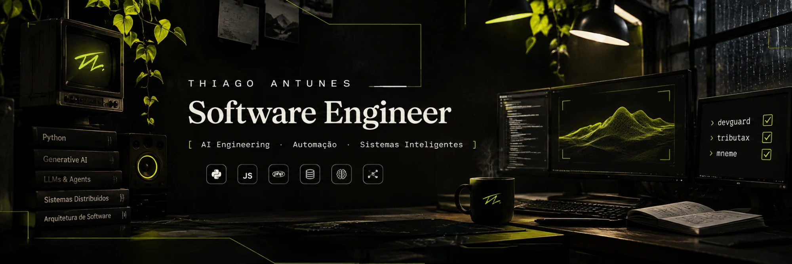

<a href="https://thiagoantunes.com">
  
</a>

<p align="center">
  <a href="https://thiagoantunes.com">
    
  </a>
</p>

<p align="center">
  <a href="https://thiagoantunes.com"></a>
  <a href="https://www.linkedin.com/in/thiagofilipeantunes"></a>
  <a href="mailto:thiagofsprofissional@gmail.com"></a>
  
</p>


<p align="center">
  
</p>

Sou **Engenheiro de Software na 3D Lab**, estudante de **Engenharia de Software** e tecnólogo em **Análise e Desenvolvimento de Sistemas**. Trabalho no **ERP interno** da empresa, arquitetando e entregando features fullstack, integrações via API e automações que resolvem problemas reais do negócio.

Uso **IA generativa, LLMs e agentes** (Claude Code, Codex) como parte do fluxo de engenharia: analisar código, gerar scripts, testar, refinar e acelerar entregas. E levo a mesma ideia para os meus projetos: **nenhuma decisão sem evidência**, seja um sinal de trading na [MNEME](https://github.com/th1agx/MNEME) ou um imposto calculado no [Tributax](https://github.com/th1agx/Tributax-Motor-Tributario).

```yaml
agora:
  trabalhando_em:  ERP interno · 3D Lab
  construindo:     MNEME (IA financeira) · Tributax (motor tributário)
  estudando:       Engenharia de Software · RAG · agentes multi-etapa
  fora_do_código:  produção musical e beatmaking desde 2019 🎧
```


<p align="center"><b><code>IA &amp; Agentes</code></b></p>
<p align="center">
  
  
  
  
  
  
  
  
  
</p>

<p align="center"><b><code>Linguagens, back-end &amp; dados</code></b></p>
<p align="center">
  <a href="https://skillicons.dev"></a>
</p>

<p align="center"><b><code>Front-end, motion &amp; ferramentas</code></b></p>
<p align="center">
  <a href="https://skillicons.dev"></a>
</p>


<p align="center">
  <a href="https://github.com/th1agx/MNEME"></a>
  <a href="https://github.com/th1agx/Tributax-Motor-Tributario"></a>
  <a href="https://github.com/th1agx/devguard-skill"></a>
  <a href="https://github.com/th1agx/Portifolio_ThiagoAntunes"></a>
  <a href="https://github.com/th1agx/little-worlds"></a>
  <a href="https://github.com/th1agx/English-Learning-Experience"></a>
</p>

<p align="center">
  <b>Ao vivo&nbsp;→</b>
  <a href="https://mneme-1b8.pages.dev/">MNEME</a> ·
  <a href="https://tributax-api.onrender.com/docs">Tributax API (Swagger)</a> ·
  <a href="https://thiagoantunes.com">thiagoantunes.com</a> ·
  <a href="https://th1agx.github.io/English-Learning-Experience/">English Learning</a>
</p>

<details>
<summary><b>Mais projetos</b></summary>
<br />

| Projeto | Stack | Sobre |
|---|---|---|
| [**IPITO**](https://github.com/th1agx/ipito-the-marketplace) | em planejamento | Marketplace brasileiro para adegas, tabacarias e lojas de acessórios |
| [**Forza Horizon 5 Auto Drive**](https://github.com/th1agx/Python---Forza-Horizon-5-Auto-Drive-XP-Farm.) | Python | Automação de corridas com simulação de teclado e controle de tempo para farm de XP |
| [**Gestão de Academias**](https://github.com/th1agx/Sistema-de-Gest-o-de-Academias) | Python · Tkinter · SQLite | Sistema MVC com CLI e GUI para clientes e treinadores |
| [**Gerenciamento de Produtos**](https://github.com/th1agx/Sistema-de-Gerenciamento-de-Produtos) | JavaScript | CRUD com relatório de estoque e alerta de baixa quantidade (desafio técnico da 3D Lab) |
| [**Jogo do Número Secreto**](https://github.com/th1agx/Projeto-Jogo-do-Numero-Secreto) | JavaScript · HTML · CSS | Jogo de adivinhação com dicas a cada tentativa |
| [**Site de Beats**](https://github.com/th1agx/Projeto-desenvolvimento-WEB) | HTML · CSS | Front-end de uma loja de beats, feito na graduação |

</details>


```diff
+ 06/2026 → hoje     Engenheiro de Software Júnior · 3D Lab · BH
+                    ERP interno fullstack · Python · IA generativa · agentes · APIs · JS · PHP/Laravel
! 03/2026 → 06/2026  Estagiário de Tecnologia e Processos · 3D Lab · BH
!                    módulos do ERP em JavaScript · Nest.js · Next.js · integrações PHP · Claude Code
# 2025 → hoje        Engenharia de Software · Estácio
# 2022 → 2024        Análise e Desenvolvimento de Sistemas · Estácio (concluído)
@ 2019 → hoje        Beatmaking e produção musical · autônomo
```

<details>
<summary><b>Experiência em detalhes</b></summary>
<br />

**Engenheiro de Software Júnior · 3D Lab** · *06/2026 – atual*
- Arquitetura, planejamento e implementação de features fullstack nos módulos do **ERP interno**
- **Python, IA generativa, LLMs, agentes e prompt engineering** aplicados a análise de código, scripts, automações e produtividade
- **Claude Code e Codex** no apoio ao desenvolvimento, refino de código, testes e otimização de fluxos
- Soluções com **JavaScript, PHP, Laravel, Python, bancos de dados e integrações via API**
- Testes, validação de funcionalidades, análise de bugs e melhoria contínua

**Estagiário de Tecnologia e Processos · 3D Lab** · *03/2026 – 06/2026*
- Módulos do **ERP interno** com foco em **JavaScript**, com **Nest.js** no back-end e **Next.js** no front-end
- **PHP** em integrações com sistemas internos
- **GenAI, LLMs e agentes** (Claude Code) para refino de código, scripts e automações

**Beatmaking e Produção Musical · Autônomo** · *02/2019 – atual*
- Produção, criação de beats e projetos criativos independentes, com entrega sob demanda

</details>

<details>
<summary><b>Certificados</b></summary>
<br />

| Certificado | Instituição |
|---|---|
| Introduction to AI | Google |
| Revelando o poder dos Agentes de IA | IBM |
| Python 2026: Do Básico ao Avançado | Udemy |
| Desenvolvimento Rápido de Aplicações em Python | Estácio |
| Programação de Algoritmos Escaláveis | Estácio |
| Git e GitHub: compartilhando e colaborando em projetos | Alura |
| Mergulhe em programação com JavaScript | Alura |
| Quality Assurance: plano de testes e gestão de bugs | Alura |
| Banco de Dados e SQL | AlgaWorks |

🌍 **Idiomas:** 🇧🇷 Português (nativo) · 🇺🇸 Inglês (intermediário)

</details>


<p align="center">
  
</p>


<picture>
  <source media="(prefers-color-scheme: dark)" srcset="https://raw.githubusercontent.com/th1agx/th1agx/output/github-snake-dark.svg" />
  <source media="(prefers-color-scheme: light)" srcset="https://raw.githubusercontent.com/th1agx/th1agx/output/github-snake.svg" />
  
</picture>
